# cargadgetd

Let's talk to the car :D

Wip, early access whatever, can be downloaded from ftuna.eu repositories

Talks to the car over USB (maybe wireless in future idk), using android auto protocol.

## Screenshots

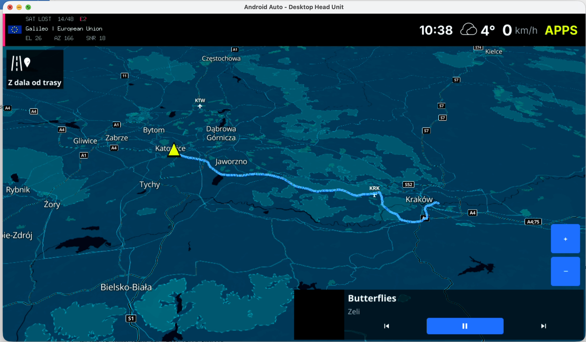

|  |  |  |  |
|:-:|:-:|:-:|:-:|
| 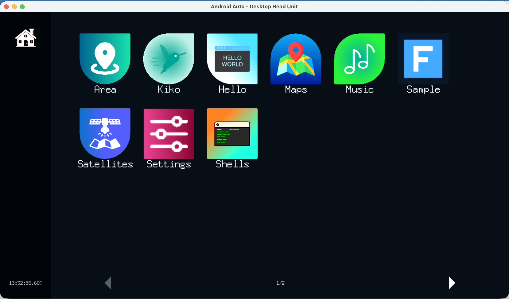 | 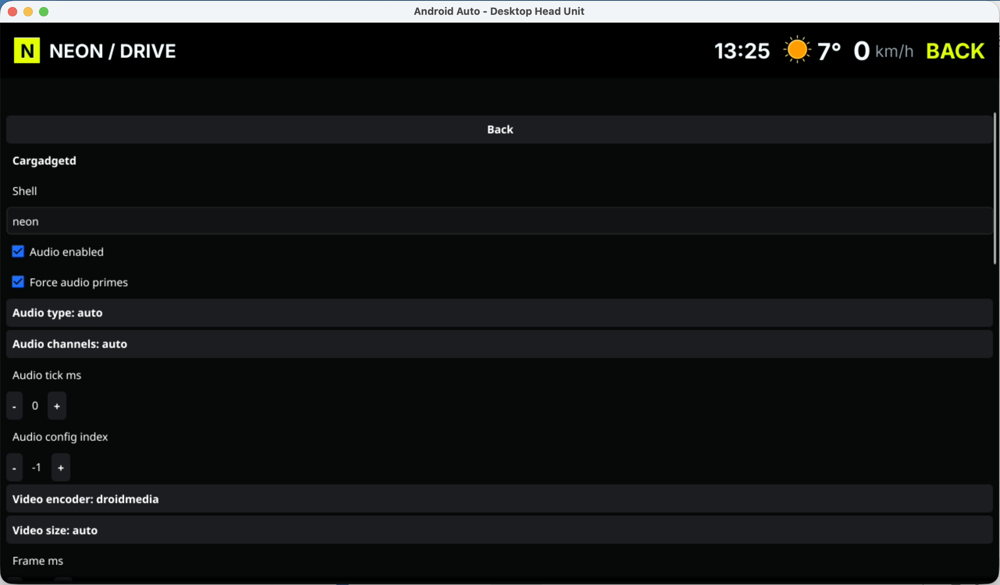 | 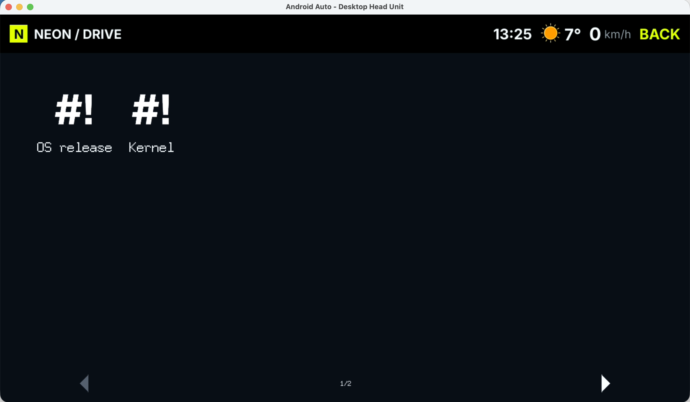 | 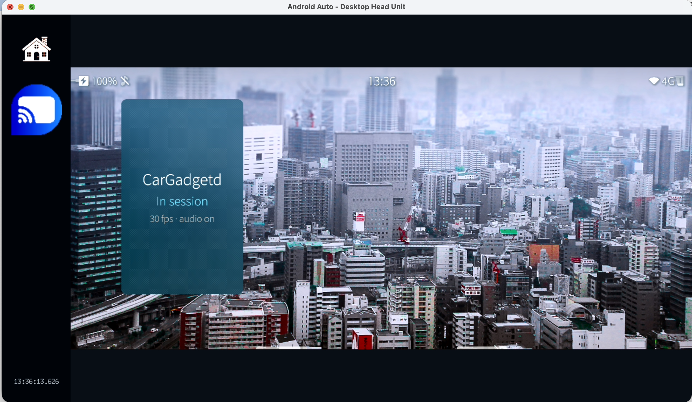 |
| 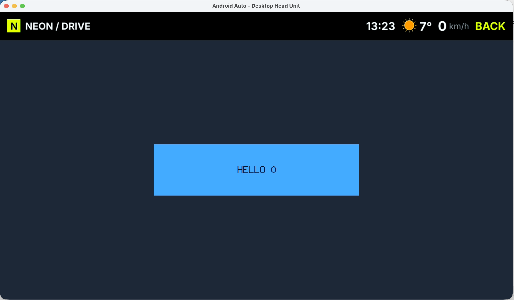 | 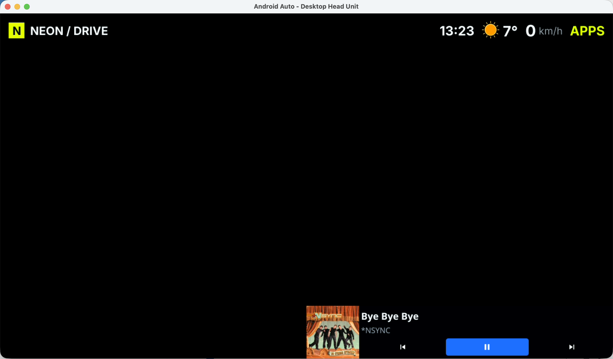 | 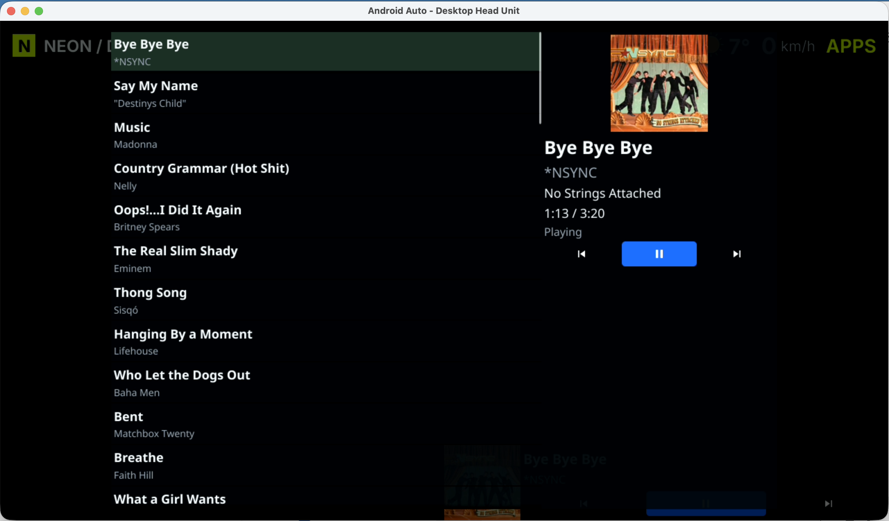 | 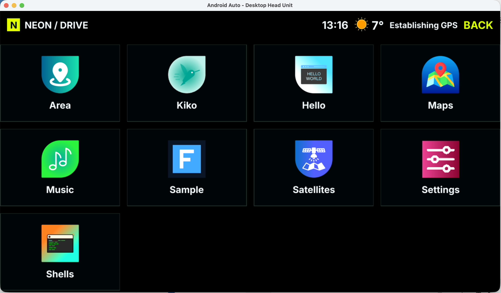 |
| 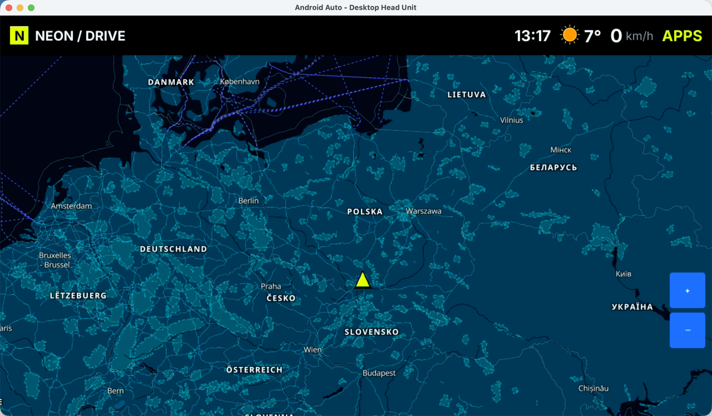 | 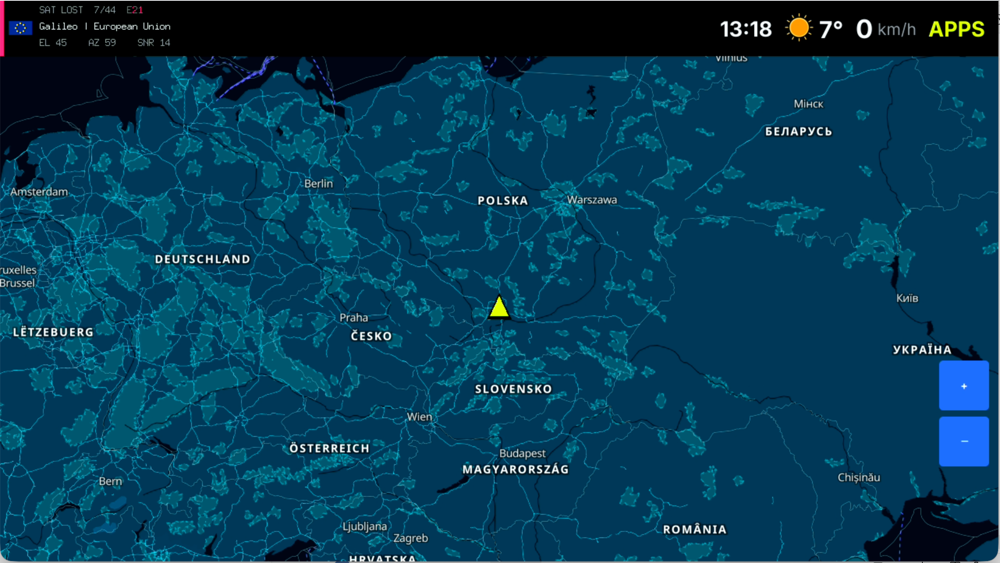 | 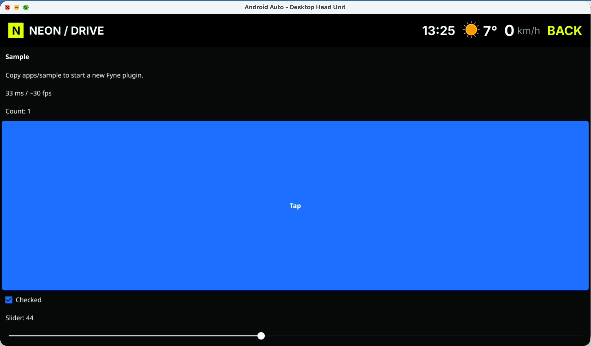 | 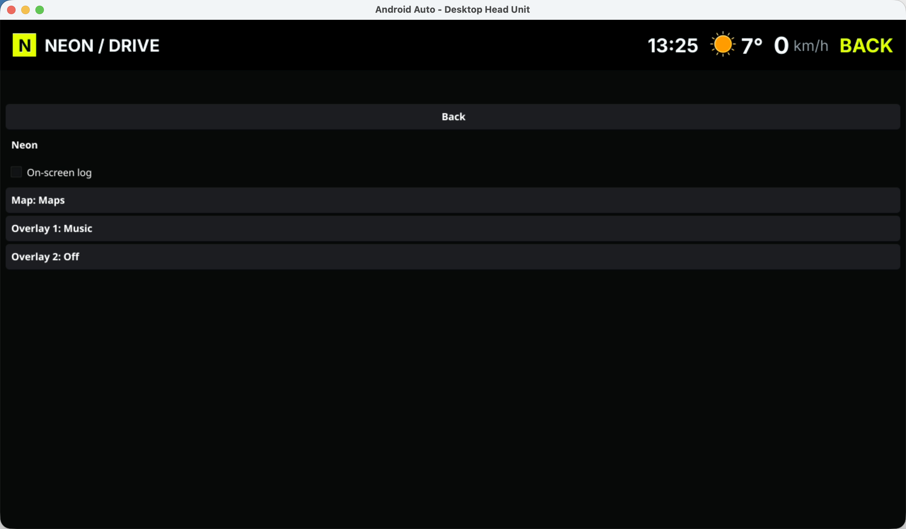 |
| 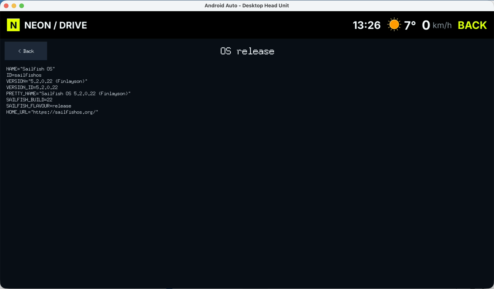 | 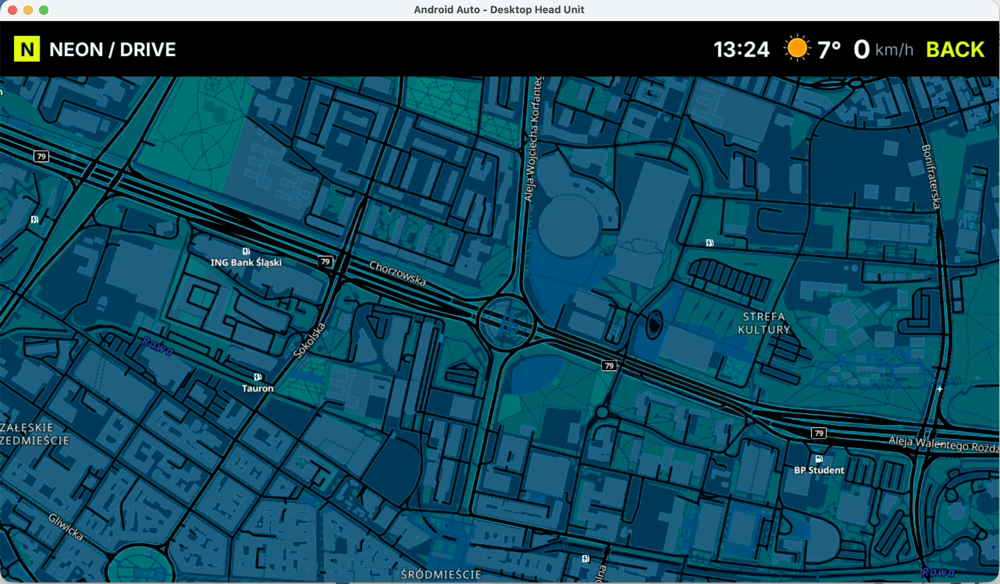 | 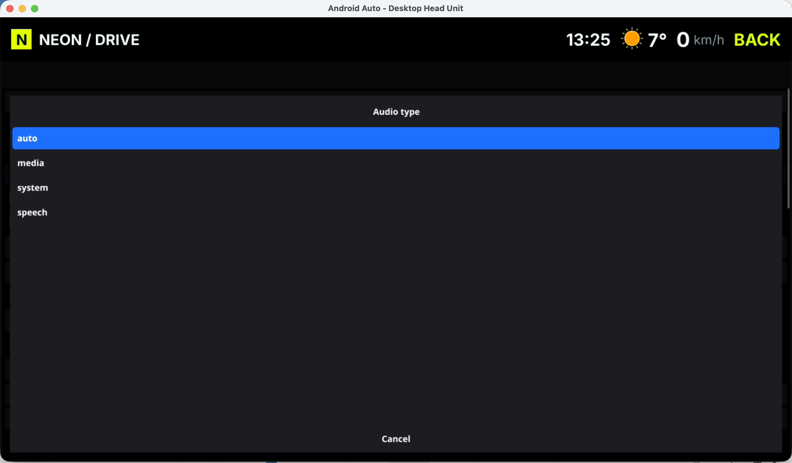 | 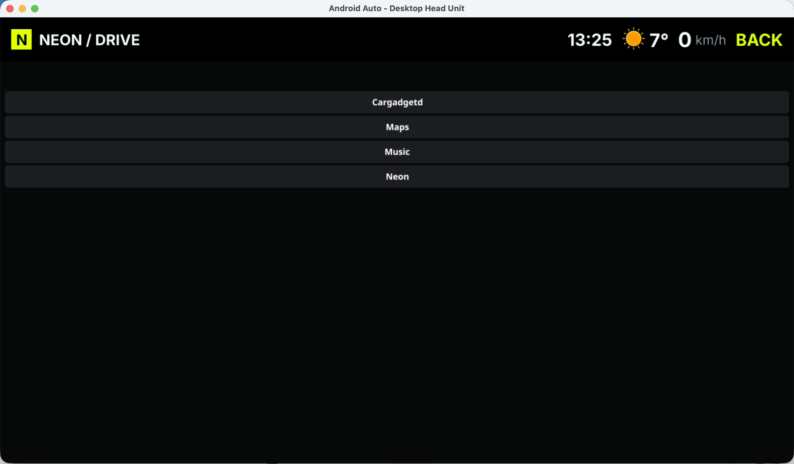 |

Cargadgetd is fully modular and customizable. You can create your own shells, apps, plugins.. Everything!

Apps:

- [Settings](https://github.com/MrCyjaneK/cargadgetd_app_settings)
- [Maps](https://github.com/MrCyjaneK/cargadgetd_app_maps)
- [Music](https://github.com/MrCyjaneK/cargadgetd_app_music)
- [Link](https://github.com/MrCyjaneK/cargadgetd_app_link)
- [Sats](https://github.com/MrCyjaneK/cargadgetd_app_sats)
- [Shells](https://github.com/MrCyjaneK/cargadgetd_app_shells)
- [Hello World!](https://github.com/MrCyjaneK/cargadgetd_app_hello)
- [Fyne Sample](https://github.com/MrCyjaneK/cargadgetd_app_sample)

Shells:
- [Neon](https://github.com/MrCyjaneK/cargadgetd_shell_neon)
- [Basic](https://github.com/MrCyjaneK/cargadgetd_shell_basic)

If you have any questions feel free to open an issue or contact me on Telegram - at the [Sailfish fan club](https://t.me/SFOSFanclub).

----

Special thanks to @gregguh for the awesome project logo!